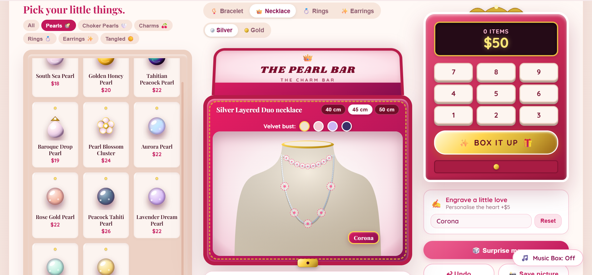
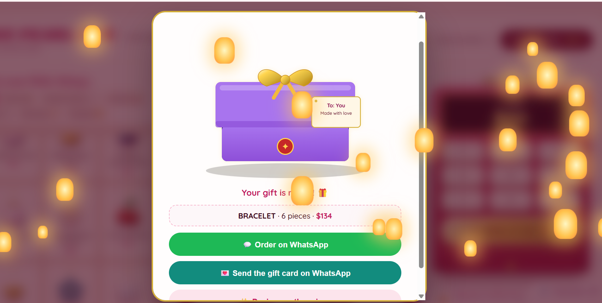

# 💎 The Pearl Bar: Interactive Jewelry Designer

Design your own necklace, bracelet or earrings, pack it as a gift and send the order on WhatsApp.

🔗 **Live demo:** https://anumnoor-dev.github.io/pearl-bar-jewelry-designer/




## ✨ Features

- **15 style cards** (5 necklaces, 5 bracelets, 5 earrings). Every style renders a different design.
- **Layered necklace on a velvet bust:** a choker of small pearls plus a chain of pendants.
- **40+ pieces:** shiny twinkling pearls, gems and charms, plus ring designs (V-crown and floral).
- **Live price** on a vintage cash register, with a currency switcher.
- Silver / gold switch, engraving, **Surprise me**, **Undo** and **Save picture (PNG)**.
- **Gift Studio:** choose a wrap, write a gift card, and watch an animated packing sequence (tissue, lid, ribbon, tag, wax seal) with floating lanterns.
- **WhatsApp integration** to send the order or the gift card.
- Everything resets after packing, ready for the next design.

## 🛠 Tech stack

HTML5 · CSS3 (gradients, keyframe animations) · Vanilla JavaScript (ES6) · SVG · Web Audio API. No frameworks or libraries.

## 🚀 Run locally

Download the repository and open `index.html` in your browser. No installation needed.

## 📁 Project structure

```
├── index.html        # page structure
├── style.css         # styling and animations
├── script.js         # state, SVG rendering, gift studio, WhatsApp
├── preview.png       # screenshot
└── gift-studio.png   # screenshot
```

## 🧠 What I learned

- Managing app state without a framework (separate slots for each jewelry type)
- Generating SVG dynamically from data
- Sequencing animations with CSS and JavaScript timers
- Designing a complete user flow: pick a style → design → pack → order

## 🔮 Future ideas

- Save orders with PHP and MySQL
- Admin dashboard to manage orders
- Real product photos and online payment

## 👩‍💻 Author

**Noor**: [LinkedIn](www.linkedin.com/in/anum-noor-77b184416)

*Built with AI assistance (Claude) as a pair-programmer. Concept, design direction, testing and customization by me.*
